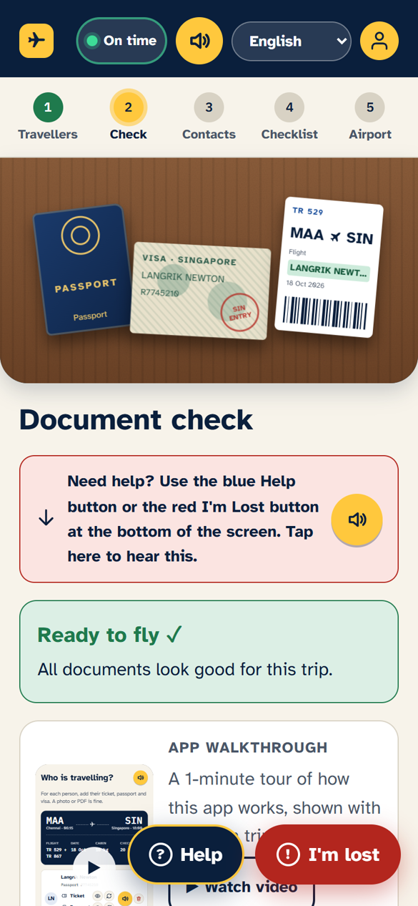
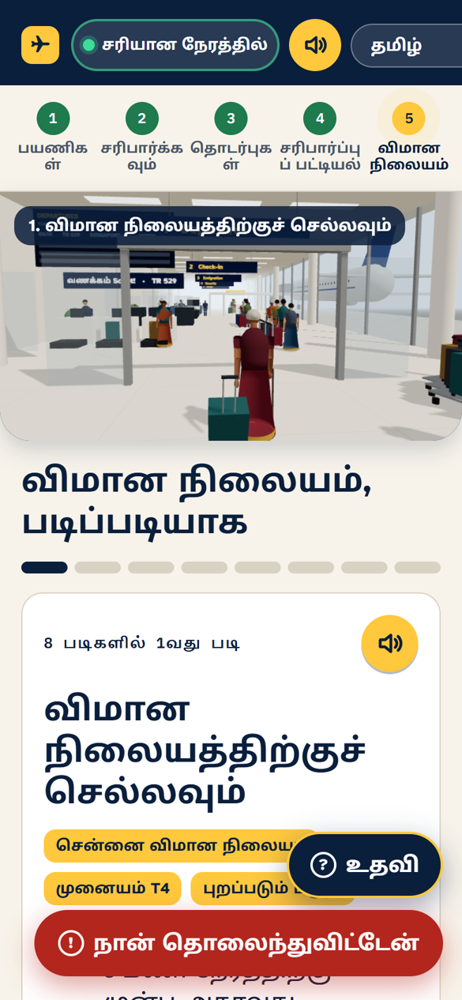
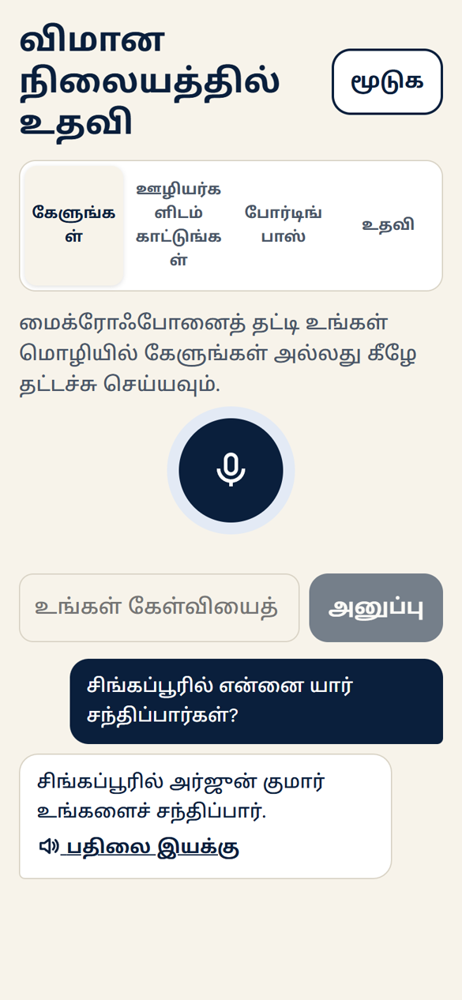
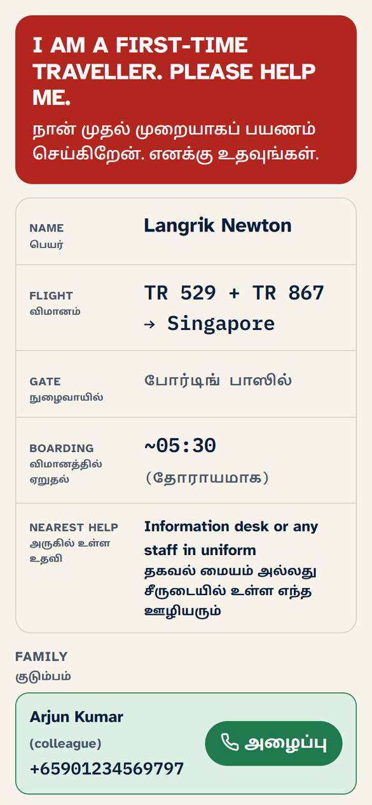
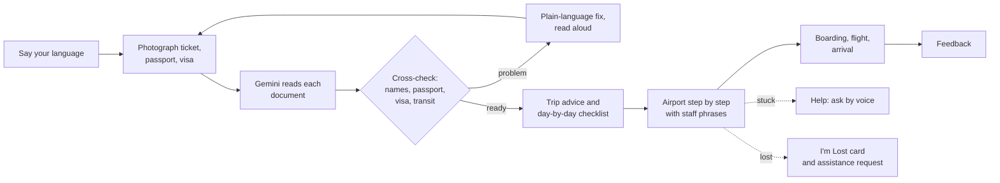
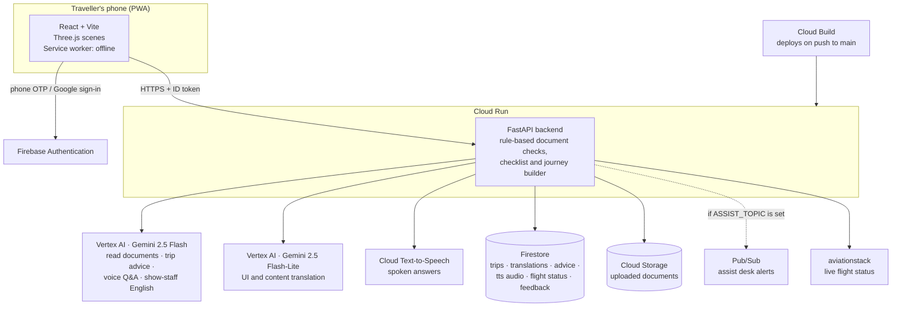
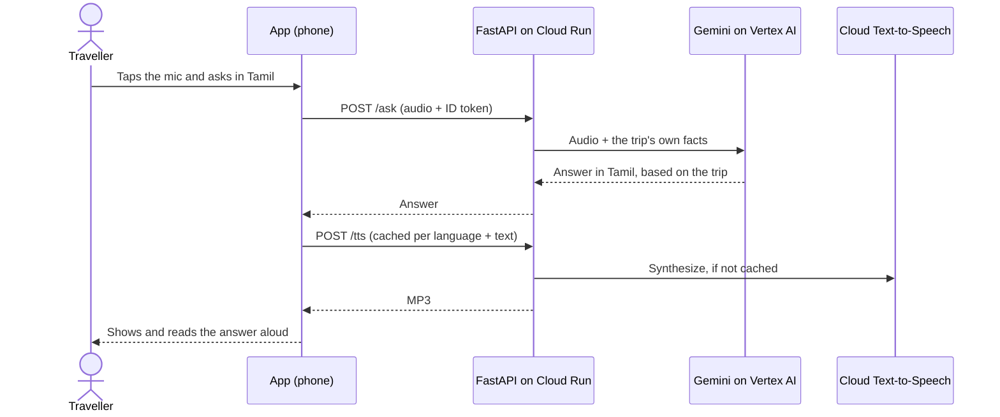

# MyFirstFlightAI

**A voice-first guide for people taking their very first flight**, built for travellers who can't read English, and often not their own language either.

MyFirstFlightAI reads the traveller's own ticket, passport and visa. It checks them at home and builds the whole trip from them. Then it walks the traveller through the airport step by step, out loud, in their language. If they get stuck, they ask a question in their own words or show staff a single "I'm lost" card.

🔗 **Live app:** https://myfirstflightai-964832886801.us-central1.run.app/

---

## Highlights

| | |
|---|---|
| 🗣️ **Voice-first, 20 languages** | The traveller says their language to pick it. Every screen, step and answer can be read aloud. The languages are Indian languages plus Arabic (right-to-left), Chinese, Japanese, Korean, Thai and major European languages |
| 📄 **Built from real documents** | Gemini reads the ticket, passport and visa. Rules then cross-check names, passport validity, visa country and dates, and transits. The trip summary, advice and checklist all come from these documents |
| ✅ **Personal checklist** | Steps for the days before the flight: the baggage allowance from the ticket, when to leave home, arrival cards, assistance needs, and fixes for any document problem |
| 🛫 **Airport, step by step** | Terminal, gate and boarding time come from the trip. Each step has a sentence ready to show staff in English, with the traveller's language underneath |
| 🎬 **See it before you live it** | Animated scenes at the top of each step, a 3D walk through the terminal, a boarding scene with the traveller's own airline, and a short story of the whole journey |
| 🆘 **Help & I'm Lost** | Ask anything by voice and get a spoken answer drawn from the trip's own details. The I'm Lost card is in English for staff and has a one-tap call to family |
| ⏱️ **Live flight status** | A status chip in the top bar, and a warning in the traveller's language if the flight is delayed or cancelled |
| 📴 **Works offline** | An installable app (PWA) that still opens with no signal. The walkthrough video can be downloaded |
| 💬 **Feedback** | A rating with faces, "what helped most", and a spoken comment when the trip ends |

## Screenshots

| AI document check | Airport steps (Tamil) | Voice help (Tamil) | I'm Lost card |
|:---:|:---:|:---:|:---:|
|  |  |  |  |
| Documents read by Gemini, cross-checked, and marked "ready to fly" | A 3D terminal scene and the first step in the traveller's language | Asked in Tamil, answered in Tamil from the trip details | Shown to any staff member, with a one-tap call to family |

---

## How it works

### The traveller's journey



### Architecture on Google Cloud



### Voice help, end to end



### Google Cloud services used

| Service | Used for |
|---|---|
| **Vertex AI: Gemini 2.5 Flash** | Reading tickets, passports, visas and boarding passes into strict JSON; destination advice; answering voice and text questions from the trip's facts; turning a spoken need into English for staff; recognising a spoken language name |
| **Vertex AI: Gemini 2.5 Flash-Lite** | Translating screen text and trip content into 20 languages |
| **Cloud Text-to-Speech** | Reading every line and answer aloud |
| **Cloud Run** | Hosting the frontend (nginx) and the FastAPI backend |
| **Cloud Build** | CI/CD: deploys both services on every push to `main` |
| **Firestore** | Trips, plus caches for translations, advice, TTS audio and flight status, feedback, and assistance requests |
| **Cloud Storage** | The uploaded document files |
| **Pub/Sub** | Assistance and I'm Lost alerts to an airport assist desk (optional, via `ASSIST_TOPIC`) |
| **Firebase Authentication** | Phone OTP and Google sign-in |

**Caching keeps the app fast and cheap.** Screen text is pre-translated at build time (`backend/tools/gen_ui_locales.py`); any missing text is translated once and cached. Spoken audio is cached per language and exact text. Advice is cached for 30 days and flight status for 30 minutes.

---

## Repository structure

```
MyFirstFlightAI/
├── frontend/                  # React (Vite) app served by nginx
│   ├── src/screens/           # Language, Travellers, Check, Contacts, Checklist, Journey, Trips, Landing, Auth
│   ├── src/components/        # Help sheet, I'm Lost card, Stage scenes, Story, Listen (read aloud), flight alert
│   ├── src/three/             # Three.js: globe, terminal walk, boarding/arrival moments, intro story
│   ├── src/locales/           # en.json (source) + 19 pre-translated languages
│   └── public/sw.js           # Service worker (offline)
├── backend/                   # FastAPI on Cloud Run
│   ├── main.py                # API routes
│   ├── gemini.py              # Gemini on Vertex AI: extraction, advice, Q&A, translation
│   ├── validation.py          # Rule engine: names, 6-month passport rule, visa, transit
│   ├── checklist.py / journey.py / advice.py
│   ├── flight_status.py       # Live status + delay/cancellation alerts
│   ├── gcp.py                 # Text-to-Speech, Pub/Sub
│   ├── db.py                  # Firestore + Cloud Storage (or in-memory)
│   ├── tools/gen_ui_locales.py
│   └── tests/                 # pytest suite (Gemini mocked)
├── cloudbuild-backend.yaml
└── cloudbuild-frontend.yaml
```

## Local development

### Backend (FastAPI)

```bash
cd backend
python -m venv venv
.\venv\Scripts\Activate.ps1        # Windows PowerShell
# source venv/bin/activate         # Linux/macOS
pip install -r requirements.txt

# copy .env.example to .env and put sa-key.json in backend/ (both gitignored)
# DB_BACKEND=memory runs without Firestore
uvicorn main:app --reload --port 8000     # API docs at http://127.0.0.1:8000/docs

python -m pytest tests                     # no GCP access needed
```

| Variable | Purpose |
|---|---|
| `USE_VERTEX_AI`, `GCP_PROJECT_ID` | Use Gemini on Vertex AI in this project |
| `GEMINI_MODEL` | Main model (default `gemini-2.5-flash`) |
| `GEMINI_LOCATION` | Vertex AI endpoint for Gemini (default `global`) |
| `GCP_LOCATION` | Region for the Cloud Storage bucket (default `us-central1`) |
| `DB_BACKEND` | `firestore` (default) or `memory` |
| `AVIATIONSTACK_KEY` | Live flight status |
| `FLIGHT_STATUS_DEMO` | Fake a status for test flights, e.g. `SL301=delayed:45:B12` |
| `ASSIST_TOPIC` | Pub/Sub topic for assist-desk alerts (optional) |

After changing `frontend/src/locales/en.json`, re-run `python tools/gen_ui_locales.py` so every language is pre-translated.

### Frontend (React + Vite)

```bash
cd frontend
npm install
npm run dev        # http://localhost:5173
npm run lint
```

The frontend reads `VITE_API_BASE_URL` and the `VITE_FIREBASE_*` keys from `frontend/.env`. Set `VITE_FIREBASE_TEST_MODE=true` only on your machine, to sign in with Firebase test numbers without reCAPTCHA. Never set it in production.

## Deployment

A push to `main` triggers both Cloud Build pipelines (`cloudbuild-backend.yaml`, `cloudbuild-frontend.yaml`). Each builds a container and deploys it to Cloud Run.

**One-time GCP setup:** create a Firestore database (Native mode), enable the Vertex AI and Text-to-Speech APIs, and give the Cloud Run service account access to Firestore (`Cloud Datastore User`), Vertex AI and the documents bucket.

## Roadmap

- **Personalised experience** that learns each traveller's needs over time
- **Airport maps** with walking directions to the next step
- **Restaurants and shops** at the airport, with shopping inside the app
- **Direct assist-desk integration**, so an I'm Lost alert brings airport staff to the traveller
